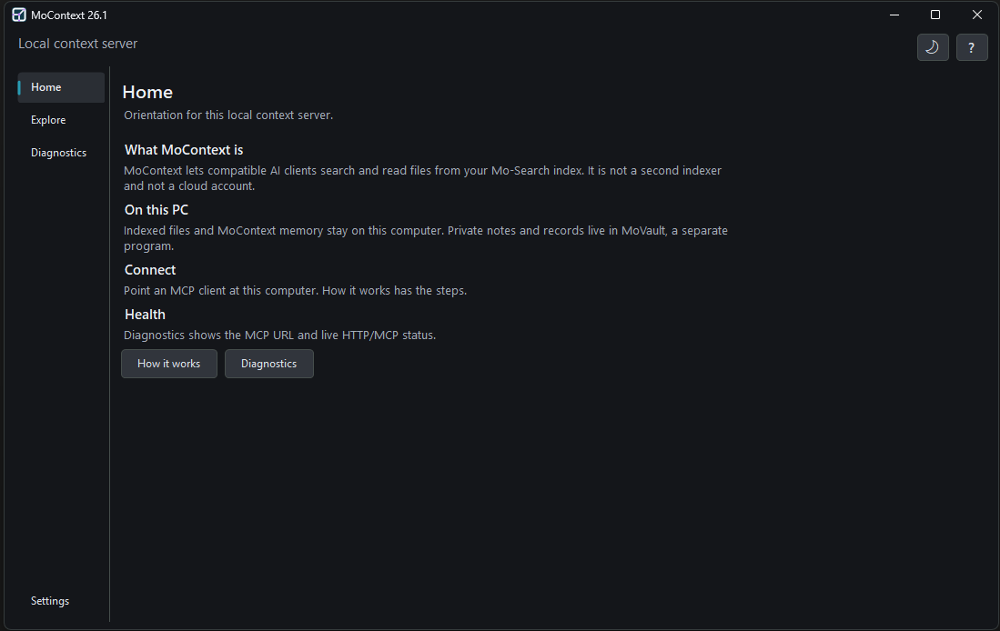

# MoContext

> Documentation baseline: Mo-Search/MoContext 26.1, the current public
> release.

**Give your AI agent full-text search over the files you index on your Windows
computer.**

MoContext is a local [MCP](https://modelcontextprotocol.io) server that shares
the [Mo-Search](https://www.meauxsoft.com) desktop search index with AI agents.
Mo-Search has been indexing Windows machines since 2005 — millions of files,
full text, ranked results in milliseconds. MoContext puts that index behind 15
MCP tools so Codex, Claude Code, Cursor, Devin, VS Code, or another
compatible MCP client can find and read indexed files — plus keep durable,
human-editable session memory.



The screenshot above is the MoContext 26.1 local context server. A workflow GIF
is planned for a later release.

## Why

- **The index already exists.** Mo-Search provides the user with a fast
  full-text index of their entire machine. MoContext is a read-mostly MCP layer
  over it — no separate crawler, no re-indexing, no embedding pipeline.
- **Beyond one repo.** Your agent can answer "where did I handle this before?"
  across the projects, documents, and notes included in your Mo-Search index —
  including files you last touched years ago.
- **Local service and index.** MoContext listens on `127.0.0.1` by default,
  reads the local Mo-Search index, and does not require a MoContext cloud
  account. See [Privacy](#privacy) for the important AI-client boundary.
- **Schema beats prompts.** Session memory (`SaveContext`) uses a structured
  digest schema with a server-side quality gate, plus an auto-generated weekly
  rollup — so "what did we do last week?" has a real answer.

## Quick start

1. **Install [Mo-Search](https://www.meauxsoft.com)** (Windows 10/11).
   MoContext is included in the same installer. Tick its box on the installer's
   finish page, or turn it on in Mo-Search's settings, then finish its short
   setup.
2. **Connect your client** to `http://127.0.0.1:43210/mcp`:

The [guided setup helper](https://www.meauxsoft.com/MoContext.html#connect)
lets you select your editor or assistant and shows the matching steps. Use
Reset there to configure another client. The examples below also work directly.

MoContext must be running on the same Windows PC as your client. The extension
setup paths below need neither Node.js nor a separately installed client CLI.

**Codex extension for VS Code**

1. Open the Codex panel's gear menu, then **Codex Settings > Open config.toml**.
   This opens your user configuration (`%USERPROFILE%\.codex\config.toml`
   on Windows).
2. Add the following section, preserving existing settings. If a
   `[mcp_servers.mocontext]` section already exists, update it instead of
   adding a duplicate:

```toml
[mcp_servers.mocontext]
url = "http://127.0.0.1:43210/mcp"
```

3. Save, run **Developer: Reload Window** from the VS Code Command Palette
   (`Ctrl+Shift+P`), and start a new Codex conversation.
4. Ask: **Use MoContext to get the server summary.**

[Official Codex configuration instructions](https://learn.chatgpt.com/docs/config-file/config-basic)
and [MCP documentation](https://learn.chatgpt.com/docs/extend/mcp).

If you already have the **Codex CLI** installed, you can use this alternative:

```
codex mcp add mocontext --url http://127.0.0.1:43210/mcp
```

**Claude Code extension for VS Code**

In extension version **2.1.261 or later**, type `/mcp` in the Claude chat
panel, choose to add a server, and enter:

- Name: `mocontext`
- Transport: HTTP
- URL: `http://127.0.0.1:43210/mcp`
- Scope: user, to make it available across your projects on this PC

Save, then ask: **Use MoContext to get the server summary.** The extension
bundles the runtime it needs; a separate `claude` terminal command is optional.

For a manual project setup, including older extensions, create `.mcp.json`
in the root of the project folder open in VS Code. If the file already exists,
merge the `mocontext` entry into its existing `mcpServers` object:

```json
{
  "mcpServers": {
    "mocontext": {
      "type": "http",
      "url": "http://127.0.0.1:43210/mcp"
    }
  }
}
```

Save, run **Developer: Reload Window**, start a new Claude conversation, and
approve the project server when prompted. Use `/mcp` to check its connection,
then ask for the server summary. This file configures this project; repeat in
other projects if needed. Claude Code uses `.mcp.json` at the project root,
whereas VS Code's Copilot integration uses `.vscode/mcp.json`.

[Official Claude Code extension instructions](https://code.claude.com/docs/en/vs-code#connect-to-external-tools-with-mcp)
and [MCP configuration and scopes](https://code.claude.com/docs/en/mcp).

If you already have the **Claude Code CLI** installed, you can use this
alternative (user scope makes it available across projects):

```
claude mcp add --transport http --scope user mocontext http://127.0.0.1:43210/mcp
```

**Cursor** (`~/.cursor/mcp.json` or `.cursor/mcp.json` in a project)

```json
{ "mcpServers": { "mocontext": { "url": "http://127.0.0.1:43210/mcp" } } }
```

[Official Cursor MCP documentation](https://cursor.com/docs/context/mcp)

**GitHub Copilot in VS Code** (`.vscode/mcp.json`)

```json
{ "servers": { "mocontext": { "type": "http", "url": "http://127.0.0.1:43210/mcp" } } }
```

[Official VS Code MCP configuration reference](https://code.visualstudio.com/docs/agents/reference/mcp-configuration)

**Devin Desktop** (`%APPDATA%\devin\mcp_config.json`)

```json
{ "mcpServers": { "mocontext": { "url": "http://127.0.0.1:43210/mcp" } } }
```

[Official Devin Desktop MCP documentation](https://docs.devin.ai/desktop/cascade/mcp)
and [configuration format](https://docs.devin.ai/cli/extensibility/mcp/configuration.md).

These examples follow the current client configuration formats. Client
features and configuration locations can change, so also consult the client's
official MCP documentation. Claude Desktop is not listed here because its
custom connector flow expects a remotely reachable server; packaging a
supported local Desktop extension is a separate future task.

3. **Try it** — ask your agent:

> Use MoContext to find where I configured SMTP settings, anywhere on this machine.

## Choose what your AI can reach

MoContext Settings has two access profiles, so you can limit one AI to a folder
while another sees your whole index:

- **Folder:** when a folder is set, the address above is limited to that folder.
- **Whole index:** uses the other address, shown only in MoContext Settings.

Session memory and activity stay available on both.

## The tools

| Tool | What it does |
|------|-------------|
| `get_server_summary` | One-call orientation: status, budgets, capabilities, doc/memory paths |
| `get_usage_guide` | Compact guidance for choosing tools |
| `get_health` | Liveness check; `index.newest_indexed_at` shows index recency |
| `get_diagnostics` | Verbose runtime and index details |
| `find_files` | File discovery: ranked search, recent-index browse, or hot/warm working set |
| `get_evidence_pack` | The primary retrieval tool: ranked files + bounded source windows with line numbers |
| `read_file` | Read any file: whole, range, or window around a line |
| `record_activity` | Save a lightweight work-checkpoint note |
| `get_recent_activity` | List recent notes; `group_by: "topic"` for the topic overview |
| `get_activity_briefing` | Compact recap of recent work for context injection |
| `list_context_files` | Inventory docs and memory files |
| `read_context_file` | Read one of them by scope + relative path |
| `write_memory_file` | Create/update durable Markdown memory notes |
| `save_context_digest` | `SaveContext`: structured long-term memory digest (quality-gated) |
| `load_context_digest` | `LoadContext`: recall saved digests + recent working set |

Every search result carries `last_indexed` and `mtime_newer_than_index` so the
agent knows when to re-read a file from disk instead of trusting the index.

### Bonus: checkpoints that survive context compaction

When a long agent session compacts its context window, detail is lost.
MoContext's activity journal is the antidote — and in Claude Code you can make
the checkpoint automatic with a `SessionStart` hook (its stdout is injected
into the agent's context right after every compaction). Add to
`.claude/settings.json`:

```json
{
  "hooks": {
    "SessionStart": [
      {
        "matcher": "compact",
        "hooks": [
          {
            "type": "command",
            "command": "echo Context was just compacted. Before resuming, call the MoContext record_activity tool: summary_text = concrete work completed so far (files, commits, decisions), next_step_text = the exact next action, topic_key = the ongoing thread. Then continue the task."
          }
        ]
      }
    ]
  }
}
```

The next session (or the same one, post-compaction) picks the thread back up
via `get_recent_activity` or `LoadContext`. Details in the
[AI usage guide](docs/ai-usage.md).

## How it works

Mo-Search maintains a full-text word index (SQLite) of everything you let it
index. MoContext queries that index read-only, ranks candidate files (hit
density + recency), then re-reads the winning files from disk to return exact,
current, line-numbered windows under strict response budgets — grounded
evidence, not summaries. Session memory lives in a separate local database and
in human-editable Markdown files you can open, edit, or delete anytime.

## Requirements

- Windows 10 or 11
- [Mo-Search](https://www.meauxsoft.com) installed with indexing enabled

## Docs

- [AI usage guide](docs/ai-usage.md) — the full tool/workflow reference agents read
- [Session prompt for humans](docs/human-prompt.md) — paste-able custom instructions
- [Human guide](https://www.meauxsoft.com/MoContext_Human.html) — the canonical
  browser-friendly overview on the Meauxsoft website
- [REST API examples](docs/rest-api-examples.md) — every tool is also a plain HTTP endpoint
- [Troubleshooting](docs/troubleshooting.md)
- [Changelog](CHANGELOG.md) — MoContext changes by Mo-Search release
- [Privacy](PRIVACY.md)
- [Security policy](SECURITY.md)
- [Support and issue reporting](SUPPORT.md)

## Privacy

MoContext binds to `127.0.0.1` by default. Its service, index access, activity
database, and human-editable memory files are local; MoContext does not upload
their contents to a Meauxsoft cloud service.

An AI client can still send your prompts and context returned by MoContext to
the client or model provider you chose. That provider's privacy and retention
terms apply. A fully local workflow therefore requires both MoContext **and** a
client/model stack that runs locally. See [PRIVACY.md](PRIVACY.md).

## License

The documentation in this repository is licensed [CC BY 4.0](LICENSE.md).
Mo-Search and MoContext are proprietary software. MoContext is currently
included with Mo-Search; see the current product page
and [LICENSE.md](LICENSE.md) for availability and terms. The Mo-Search license
is $50 for 365 days and currently covers Mo-Search, MoContext and MoVault.

---

Made by [Meauxsoft](https://www.meauxsoft.com). Issues are welcome in the
[issue tracker](https://github.com/Meauxsoft/mocontext/issues); private
questions can be sent to
[Questions@meauxsoft.com](mailto:Questions@meauxsoft.com).
